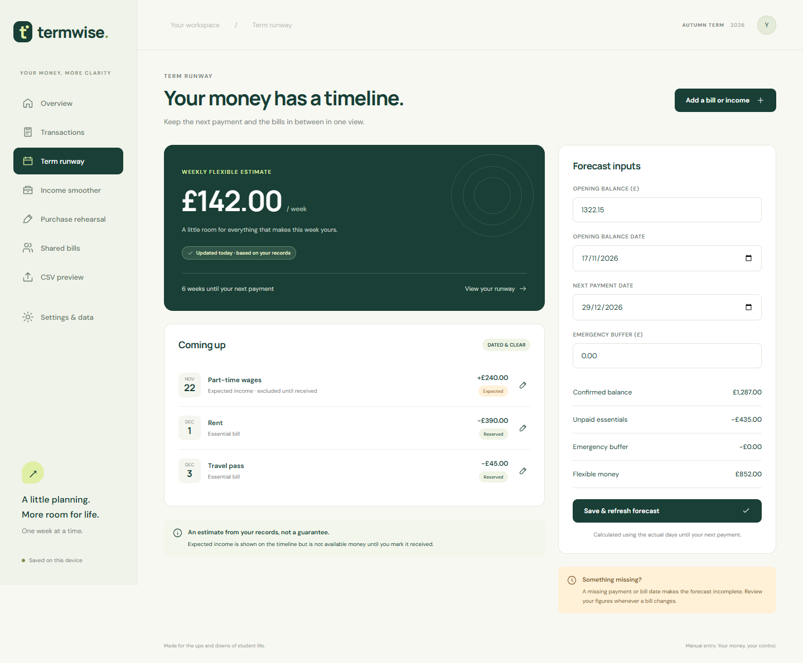
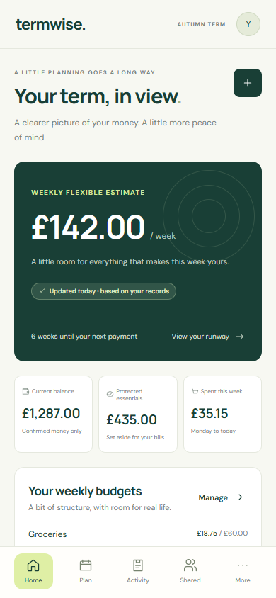

# Termwise

**A clearer weekly plan for student life.**

Termwise helps students plan between loan instalments, grants, and irregular wages. It brings confirmed money, essential bills, and everyday spending into one view so students can see what is available until their next payment.

This repository contains the core MVP from the COM435 product plan: a responsive application built with vanilla JavaScript, HTML, and CSS. It runs in the browser, uses local storage, and has no runtime package dependencies.


## Features

| Feature | Included in the MVP |
| --- | --- |
| Transactions and budgets | Record, edit, and delete expenses or received income; set weekly category limits; search, filter, and export transactions. |
| Term runway | View dated bills and expected income; set an opening balance and buffer; calculate a weekly estimate; identify incomplete or outdated inputs. |
| Income smoother | Reserve essential costs and divide the remainder into weekly allocations with exact penny reconciliation. |
| Purchase rehearsal | Compare spending before and after a proposed purchase and review essential-bill coverage without changing saved transactions. |
| Household ledger | Record shared bills; choose equal, percentage, or custom splits; track settlement locally. |
| CSV preview | Choose a file, map its columns, and review ready, duplicate, and invalid rows without adding records. |

## Screenshots

Screenshots use sample data. Dates are generated relative to the first visit.

### Term runway

The timeline keeps essential bills and expected income alongside the figures used in the forecast.



### Income smoother

The allocation view protects essential costs before spreading the flexible remainder across weeks.


### Mobile overview

The narrow-screen layout stacks the dashboard and provides bottom navigation.



## Getting started

Install **Node.js 20 or later**. There are no application dependencies to install.

```sh
git clone https://github.com/sakib-mustafa-ak/TermWise.git
cd TermWise
npm run dev
```

Open [localhost:5173](http://localhost:5173). The sample plan starts with a GBP 1,287 confirmed balance, GBP 435 in essential costs, and a GBP 142 weekly estimate over six weeks.

To enter your own figures, open **Settings & data > Start my own plan**, then add your opening balance, next payment date, bills, and spending. This clears the current local records after confirmation.

| Command | Purpose |
| --- | --- |
| `npm run dev` | Start the local server at `http://localhost:5173`. |
| `npm start` | Start the same local server. |
| `npm test` | Run the financial calculation and CSV validation tests. |
| `npm run build` | Copy the public application files into `dist/`. |

## Deployment

Deploy Termwise as a **static site**. Production does not need a Node.js server, a database, API keys, or environment variables.

| Setting | Value |
| --- | --- |
| Production branch | `main` |
| Framework preset | Other / no framework |
| Build command | `npm run build` |
| Output / publish directory | `dist` |
| Node.js version | 22 or a later supported release |

### Vercel

Import [this repository](https://github.com/sakib-mustafa-ak/TermWise) as a new Vercel project and deploy the `main` branch. The checked-in [vercel.json](./vercel.json) sets the build command and output directory. Keep the project root at the repository root.

See [Vercel's configuration reference](https://vercel.com/docs/project-configuration/vercel-json) for supported settings.

### Netlify

Import the repository into Netlify and select `main` as the production branch. The checked-in [netlify.toml](./netlify.toml) supplies the build command, publish directory, and Node.js version. Alternatively, run `npm run build` locally and upload the **contents of `dist/`** to a static host.

See [Netlify's configuration reference](https://docs.netlify.com/build/configure-builds/file-based-configuration/) for supported build settings.

Navigation uses URL fragments such as `/#plan`, so no server-side route rewrites are required. Assets use root-relative URLs; deploy at the domain root rather than a repository subpath. Only the five public application files are copied to the production build. Documentation, screenshots, coursework PDFs, and development tools are excluded.

## Data and privacy

Records are saved in `localStorage` for the current browser and origin. Saved changes survive page refreshes, but another browser, device, or deployment domain has separate data. Clearing site data removes local records. Export transactions before clearing data or changing devices.

The MVP has no authentication, cloud synchronisation, encryption layer, or backup service. Household bills form a local ledger: the application does not invite housemates, send notifications, or expose records to other accounts. Shared bills and personal transactions have separate interface views; this is not a multi-user access-control system.

Fonts are requested from Google Fonts, with local fallback fonts. The application does not send budget records to a backend.

## Calculation rules

- **Confirmed balance:** opening balance + received income - recorded expenses. The opening balance represents the start of the records being entered; avoid counting income twice.
- **Flexible money:** confirmed balance - unpaid essential bills due on or before the next payment - emergency buffer. Overdue unpaid bills remain reserved.
- **Weekly estimate:** flexible money multiplied by seven and divided by actual remaining days, rounded down to pennies. Pending income is excluded until received. Protected-cost shortfalls are shown explicitly.
- **Category budgets:** limits run Monday to Sunday. Future-dated entries do not count toward current-week spending, although saved transactions affect the confirmed balance.
- **Allocations and splits:** calculations use integer pennies. Extra pennies go to the earliest weeks or participants so totals reconcile. Saving an allocation does not credit income to the balance.
- **Forecast freshness:** source changes mark the forecast out of date. Save and refresh the inputs before using purchase rehearsal.

## CSV format

The preview accepts UTF-8 expense records with positive amounts, ISO dates, and a supported category. Map the required columns before reviewing rows. A [sample file](./sample-transactions.csv) is included.

```csv
date,description,amount,category,currency
2026-11-17,Weekly food shop,18.75,Groceries,GBP
2026-11-16,Bus ticket,4.20,Transport,GBP
```

Supported categories: Groceries, Transport, Eating out, Shopping, Entertainment, Study, and Other.

Files are limited to 2 MB and 5,000 rows. Quoted fields and embedded commas are supported. If present, `currency` must be `GBP` and `type` must be `expense`. Duplicate detection compares date, description, amount, and category against existing records and earlier rows. Exports retain transaction types; income must be entered manually rather than previewed as an expense.

CSV preview does not commit rows in this release.

## Project structure

| Path | Responsibility |
| --- | --- |
| [index.html](./index.html) | Application shell, navigation, and metadata. |
| [app.js](./app.js) | Screens, forms, interactions, and browser persistence. |
| [core.js](./core.js) | Calculations, validation, CSV parsing, and bill splits. |
| [styles.css](./styles.css) | Responsive desktop and mobile presentation. |
| [server.mjs](./server.mjs) | Local server restricted to public application files. |
| [scripts/build.mjs](./scripts/build.mjs) | Static production build. |
| [tests/core.test.mjs](./tests/core.test.mjs) | Financial and CSV regression tests. |
| [docs/screenshots/](./docs/screenshots/) | Application screenshots used above. |

## Verification and release scope

Automated tests cover valid and invalid transactions, pending-income exclusion, incomplete forecasts, essential shortfalls, penny rounding, split reconciliation, quoted CSV fields, duplicates, and malformed rows. Browser checks also cover purchase preview/discard, CSV preview without saved-data changes, and mobile navigation without horizontal page overflow.

This release implements the core scope from **Sprints 1-3**. Confirmed CSV import and Reset Week belong to Sprint 4. Consent-based support snapshots belong to Sprint 5 and require backend recipient access, expiry, and revocation before release.

The original COM435 planning PDFs are local reference material and are intentionally excluded from version control and deployment.
