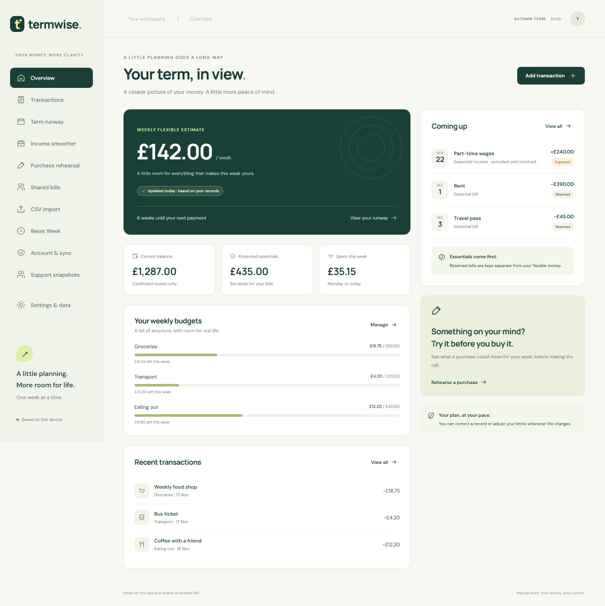
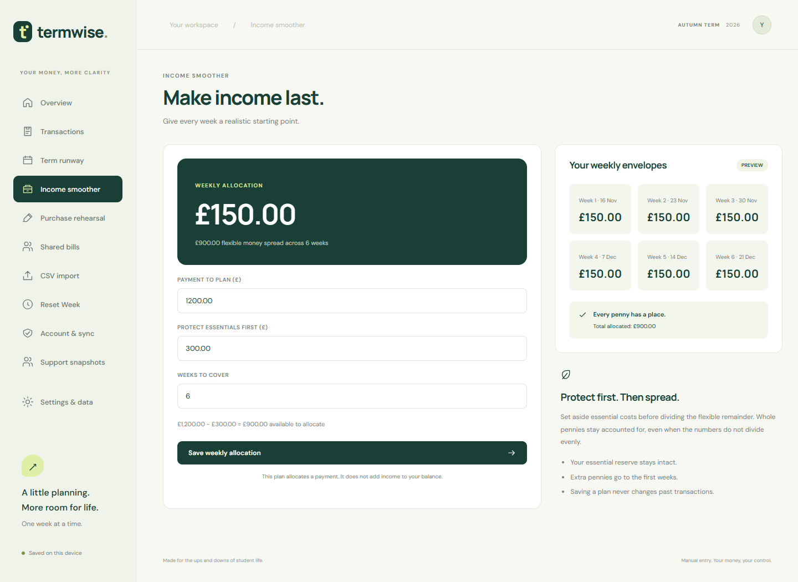

# Termwise

**A clearer weekly plan for student life.**

Termwise helps students plan between loan instalments, grants, and irregular wages. It brings confirmed money, essential bills, and everyday spending into one view so students can see what is available until their next payment.

This repository implements the budgeting and sharing features from the COM435 product plan. The responsive JavaScript application supports browser-local budgeting and optional Supabase-backed accounts, cloud sync, household collaboration, and recipient-restricted support summaries.



## Features

| Feature | Included in the MVP |
| --- | --- |
| Transactions and budgets | Record, edit, and delete expenses or received income; set weekly category limits; search, filter, and export transactions. |
| Term runway | View dated bills and expected income; set an opening balance and buffer; calculate a weekly estimate; identify incomplete or outdated inputs. |
| Income smoother | Reserve essential costs and divide the remainder into weekly allocations with exact penny reconciliation. |
| Purchase rehearsal | Compare spending before and after a proposed purchase and review essential-bill coverage without changing saved transactions. |
| Household ledger | Record local bills or collaborate online with invited household members; reconcile equal, percentage, or custom splits and track each member’s settlement. |
| CSV import | Map columns, review duplicates and errors, then explicitly confirm only the valid new expenses. Re-imports do not duplicate saved records. |
| Reset Week | Preview recovery across future weeks and selected flexible categories; protect bills and past records; undo the latest reset. |
| Accounts and sync | Email/password accounts, recovery, separate private budgets, automatic cloud saving, and conflict detection. Requires Supabase setup. |
| Support snapshots | Select categories, dates, recipient, and access duration; preview totals, confirm consent, and revoke access. Requires Supabase setup. |

## Screenshots

Screenshots use sample data. Dates are generated relative to the first visit.

### Term runway

The timeline keeps essential bills and expected income alongside the figures used in the forecast.


### Income smoother

The allocation view protects essential costs before spreading the flexible remainder across weeks.



### Mobile overview

The narrow-screen layout stacks the dashboard and provides bottom navigation.


## Getting started

Install **Node.js 22 or later** and the project dependencies.

```sh
git clone https://github.com/sakib-mustafa-ak/TermWise.git
cd TermWise
npm ci
npm run dev
```

Open [localhost:5173](http://localhost:5173). The sample plan starts with a GBP 1,287 confirmed balance, GBP 435 in essential costs, and a GBP 142 weekly estimate over six weeks.

To enter your own figures, open **Settings & data > Start my own plan**, then add your opening balance, next payment date, bills, and spending. This clears the current local records after confirmation.

| Command | Purpose |
| --- | --- |
| `npm run dev` | Start the local server at `http://localhost:5173`. |
| `npm start` | Start the same local server. |
| `npm test` | Run financial, CSV, reset, configuration, and database permission tests. |
| `npm run test:browser` | Run isolated UI/database integration checks. Install Chromium with `npx playwright install chromium` first. |
| `npm run build` | Copy the public application files into `dist/`. |

## Deployment

Deploy Termwise as a **static site**. It does not need a Node.js web server in production. Local budgeting works without backend settings. To enable accounts, cloud sync, and online sharing, follow the [Supabase setup guide](./docs/SUPABASE_SETUP.md), run its schema, and supply the two public connection variables before building.

| Setting | Value |
| --- | --- |
| Production branch | `main` |
| Framework preset | Other / no framework |
| Build command | `npm run build` |
| Output / publish directory | `dist` |
| Node.js version | 22 or a later supported release |

### Vercel

Import [this repository](https://github.com/sakib-mustafa-ak/TermWise) as a new Vercel project and deploy the `main` branch. The checked-in [vercel.json](./vercel.json) sets the build command and output directory. Keep the project root at the repository root.

See [Vercel's configuration reference](https://vercel.com/docs/project-configuration/vercel-json) for supported settings.

### Netlify

Import the repository into Netlify and select `main` as the production branch. The checked-in [netlify.toml](./netlify.toml) supplies the build command, publish directory, and Node.js version. Alternatively, run `npm run build` locally and upload the **contents of `dist/`** to a static host.

See [Netlify's configuration reference](https://docs.netlify.com/build/configure-builds/file-based-configuration/) for supported build settings.

Navigation uses URL fragments such as `/#plan`, so no server-side route rewrites are required. Assets use root-relative URLs; deploy at the domain root rather than a repository subpath. The production build contains public application modules, a bundled Supabase browser client, and generated public configuration. Documentation, tests, coursework PDFs, database SQL, and development tools are excluded. Never use a Supabase secret or service-role key in the public connection settings.

## Data and privacy

Guest records are saved in `localStorage` for the current browser and origin. Signing in opens a separate private account plan and enables automatic cloud sync when Supabase is configured. A guest plan is copied to the account only through an explicit confirmation. Normal sign-out removes the synced account cache; confirmed sign-out with unsynced changes retains a recovery copy for that account.

Cloud saves use revision checks. A stale device reports a conflict rather than replacing newer data. Sync failures preserve local changes. Export transactions before replacing a local copy or clearing browser data.

Online households expose shared bills only to authenticated members. A member can settle only their own share. Support summaries contain selected category totals and dates, never descriptions or notes. Their named recipient must sign in; database policies enforce expiry and revocation. Previously viewed or copied information cannot be erased by revocation.

Without Supabase settings, the app retains local budgeting, local shared bills, CSV import, and Reset Week. Account and online-sharing screens explain the required setup rather than simulate a connection. Authentication email delivery and hosted backend access require live deployment verification.

Fonts are requested from Google Fonts, with local fallback fonts. In cloud mode, account budget data is sent to the configured Supabase project. See the [backend guide](./docs/SUPABASE_SETUP.md) for storage, access, and recovery behavior.

## Calculation rules

- **Confirmed balance:** opening balance + received income - recorded expenses. The opening balance represents the start of the records being entered; avoid counting income twice.
- **Flexible money:** confirmed balance - unpaid essential bills due on or before the next payment - emergency buffer. Overdue unpaid bills remain reserved.
- **Weekly estimate:** flexible money multiplied by seven and divided by actual remaining days, rounded down to pennies. Pending income is excluded until received. Protected-cost shortfalls are shown explicitly.
- **Category budgets:** limits run Monday to Sunday. Future-dated entries do not count toward current-week spending, although saved transactions affect the confirmed balance.
- **Allocations and splits:** calculations use integer pennies. Extra pennies go to the earliest weeks or participants so totals reconcile. Saving an allocation does not credit income to the balance.
- **Forecast freshness:** source changes mark the forecast out of date. Save and refresh the inputs before using purchase rehearsal.

## CSV format

The preview accepts UTF-8 expense records with positive amounts, ISO dates, and a supported category. Map the required columns before reviewing rows. A [sample file](./sample-transactions.csv) is included.

```csv
date,description,amount,category,currency
2026-11-17,Weekly food shop,18.75,Groceries,GBP
2026-11-16,Bus ticket,4.20,Transport,GBP
```

Supported categories: Groceries, Transport, Eating out, Shopping, Entertainment, Study, and Other.

Files are limited to 2 MB and 5,000 rows. Quoted fields and embedded commas are supported. If present, `currency` must be `GBP` and `type` must be `expense`. Duplicate detection compares date, description, amount, and category against existing records and earlier rows. Exports retain transaction types; income must be entered manually rather than previewed as an expense.

Previewing never commits records. **Import N transactions** opens a confirmation showing the count, total cost, and excluded rows. Confirmation revalidates against the latest in-memory records and saves the batch once; repeat imports become duplicates.

## Project structure

| Path | Responsibility |
| --- | --- |
| [index.html](./index.html) | Application shell, navigation, and metadata. |
| [app.js](./app.js) | Screens, forms, interactions, and browser persistence. |
| [core.js](./core.js) | Calculations, validation, CSV import, bill splits, and recovery plans. |
| [cloud.js](./cloud.js) | Supabase authentication, versioned sync, and shared-data requests. |
| [supabase/schema.sql](./supabase/schema.sql) | Database tables, policies, and checked functions. |
| [docs/SUPABASE_SETUP.md](./docs/SUPABASE_SETUP.md) | Hosted-backend activation and verification. |
| [styles.css](./styles.css) | Responsive desktop and mobile presentation. |
| [server.mjs](./server.mjs) | Local server restricted to public application files. |
| [scripts/build.mjs](./scripts/build.mjs) | Static production build. |
| [tests/core.test.mjs](./tests/core.test.mjs) | Financial and CSV regression tests. |
| [docs/screenshots/](./docs/screenshots/) | Application screenshots used above. |

## Verification and release scope

The implementation covers the core budgeting routes and the later import, recovery, and support-sharing features. Hosted functions require the Supabase schema and public settings; they are not active merely because the static website is deployed.

Run `npm test` for calculation and database tests, then `npm run test:browser` for UI integration checks. The database checks execute the actual schema in PGlite with separate authenticated roles. Browser checks use a simulated Supabase transport backed by that database. They cover CSV confirmation, reset/undo, account isolation, household invitations and settlement, snapshot consent and revocation, and conflicting saves.

Live Supabase email confirmation, password recovery, and deployed connectivity must still be checked using the [two-account deployment checklist](./docs/SUPABASE_SETUP.md#5-verify-two-real-accounts).

The original COM435 planning PDFs are local reference material and are intentionally excluded from version control and deployment.
